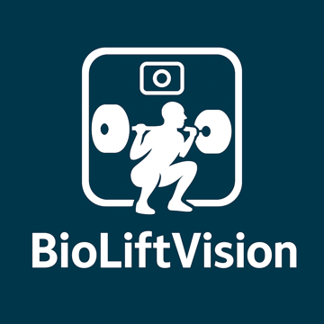
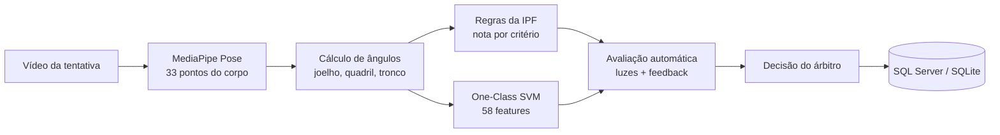

<div align="center">



# BioLiftVision

**Visão computacional para apoiar a arbitragem de movimentos do Powerlifting**

Analisa vídeos de agachamento e levantamento terra, mede os ângulos articulares do atleta
e indica se o movimento atende aos critérios do livro de regras da IPF.


</div>

---

## Sobre o projeto

No powerlifting, três árbitros decidem em poucos segundos se uma tentativa foi válida — e
detalhes como a profundidade do agachamento ou a extensão completa do quadril no terra são
difíceis de julgar a olho nu. O **BioLiftVision** é um aplicativo desktop que usa estimativa
de pose para transformar o vídeo da tentativa em medidas objetivas, oferecendo ao árbitro uma
segunda opinião fundamentada em dados.

O sistema não substitui o árbitro: ele apresenta a avaliação automática, e a decisão final
(com observações) continua sendo registrada por um juiz humano.

> Trabalho de Conclusão de Curso desenvolvido por **Fernando Maffei** e **Murillo Badio**,
> apresentado e aprovado pela banca.

## Funcionalidades

- **Análise de vídeo quadro a quadro**, de arquivo gravado ou da câmera, com esqueleto e
  ângulos sobrepostos à imagem.
- **Dois exercícios suportados:** agachamento e levantamento terra.
- **Avaliação por critérios da IPF**, com nota por critério, feedback textual e simulação
  das três luzes dos árbitros (brancas/vermelhas).
- **Modelo de aprendizado de máquina** (One-Class SVM) treinado apenas com execuções
  corretas, que sinaliza movimentos fora do padrão.
- **Fluxo do árbitro:** registro de atleta, tentativa, decisão do juiz e observações.
- **Histórico de avaliações** com exportação em CSV e TXT.
- **Tela de treinamento** para extrair features de novos vídeos e retreinar o modelo
  sem sair do aplicativo.
- **Login com perfis** (administrador e juiz), senhas com hash e salt.
- **Persistência em SQL Server**, com trilha de auditoria de alterações e SQLite local
  como alternativa.

## Como funciona



1. **Extração de pose** — o MediaPipe localiza as articulações do atleta em cada quadro.
2. **Biomecânica** — o sistema calcula ângulos 3D (joelho, quadril, inclinação do tronco),
   estabilidade e simetria ao longo do movimento.
3. **Regras** — cada critério é comparado a limiares configuráveis em
   [config/scoring_config.json](config/scoring_config.json).
4. **Modelo** — um One-Class SVM (kernel RBF) verifica se o padrão de movimento se parece
   com as execuções corretas usadas no treino.
5. **Decisão** — o árbitro confirma ou contesta a avaliação automática, e tudo fica registrado.

### Critérios avaliados

| Exercício | Critério | O que é medido |
|---|---|---|
| Agachamento | Profundidade | Ângulo do joelho no ponto mais baixo |
| Agachamento | Estabilidade | Oscilação do tronco durante a execução |
| Agachamento | Posição do tronco | Inclinação em relação à vertical |
| Terra | Lockout | Extensão do joelho no final do movimento |
| Terra | Extensão do quadril | Ângulo do quadril na posição final |
| Terra | Posição das costas | Inclinação do tronco durante a subida |
| Terra | Trajetória da barra | Desvio horizontal ao longo do levantamento |

## Resultados

Na avaliação do modelo sobre **72.216 quadros** de execuções corretas, **68.547 (94,9%)**
foram reconhecidos como dentro do padrão.

| Métrica | Valor |
|---|---|
| Quadros de execuções corretas avaliados | 72.216 |
| Reconhecidos como dentro do padrão | 68.547 (94,9%) |
| Features por quadro | 58 |
| Algoritmo | One-Class SVM (RBF) |

<details>
<summary>Como interpretar esse número</summary>

Por ser um modelo de uma classe, o conjunto de dados contém apenas movimentos corretos, e a
medição acima foi feita nos próprios dados de treino. O valor indica quanto o modelo aceita
execuções corretas; ele não mede a capacidade de rejeitar tentativas inválidas, que depende
de um conjunto rotulado com movimentos reprovados (ver [Trabalhos futuros](#trabalhos-futuros)).
A matriz gerada está em
[results_oneclass/oneclass_confusion_matrix.png](results_oneclass/oneclass_confusion_matrix.png).
A última avaliação em lote salva em
[results_oneclass/evaluation_results.json](results_oneclass/evaluation_results.json)
registrou 93,4% com a mesma metodologia.

</details>

## Tecnologias

| Camada | Ferramentas |
|---|---|
| Visão computacional | MediaPipe Pose, OpenCV |
| Aprendizado de máquina | scikit-learn, NumPy, pandas, SciPy |
| Interface | PyQt5, pyqtgraph |
| Dados | SQL Server (pyodbc), SQLite, Parquet (pyarrow) |
| Segurança | hash de senha com salt, keyring |

## Como executar

**Pré-requisitos:** Windows 10/11 64-bit, Python 3.10 (64-bit) e, para usar login e
histórico em banco, SQL Server com o *ODBC Driver 17*.

```bash
git clone https://github.com/Fernando-Maffei/BioliftVision.git
cd BioliftVision
python -m venv venv310
venv310\Scripts\activate
pip install -r requirements.txt
```

**Banco de dados**

1. Execute [database/schema.sql](database/schema.sql) no SQL Server para criar o banco
   `bioliftvisionDB`.
2. Copie `.env.example` para `.env` e ajuste servidor e autenticação
   (ou use o botão **Configurar Banco** na tela de login).
3. Crie o usuário administrador inicial e troque a senha padrão no primeiro acesso:

```bash
python -m db.bootstrap_users
```

**Aplicativo**

```bash
python main.py
```

Para abrir direto na tela de análise, sem passar pelo menu:

```bash
python main.py --analysis
```

## Estrutura do repositório

```
BioliftVision/
├── main.py              # ponto de entrada (login, menu, análise)
├── core/                # pose, ângulos, pontuação IPF, treino e inferência
├── ui/                  # telas PyQt5 (login, menu, análise, treinamento)
├── db/                  # repositórios e conexão com SQL Server
├── config/              # limiares de pontuação e parâmetros do pipeline
├── database/            # script de criação do banco
├── dataset/             # features extraídas dos vídeos de treino
├── model/               # modelos treinados e manifesto de versões
├── results_oneclass/    # métricas e matriz de avaliação
├── storage/             # persistência local (SQLite)
└── docs/                # documentação técnica
```

## Documentação

| Documento | Conteúdo |
|---|---|
| [Ambiente e execução](docs/ambiente_e_execucao.md) | Requisitos, configuração e solução de problemas |
| [Pipeline de treinamento](docs/pipeline_treinamento.md) | Extração de features, treino e avaliação |
| [Fluxo do sistema](docs/system_flow.md) | Diagrama completo das etapas |
| [Estrutura do projeto](docs/estrutura.md) | Organização dos módulos |
| [Banco de dados](docs/judicial_analysis_db.md) | Esquema, auditoria e API de repositório |
| [Configuração do banco](docs/database_config.md) | Conexões e variáveis de ambiente |

As regras de referência estão no
[livro de regras da IPF (edição 2024, em português)](docs/referencias/livro_de_regras_ipf_2024.pdf).

## Trabalhos futuros

- Montar um conjunto rotulado com tentativas inválidas para medir a taxa de rejeição.
- Incluir o supino, completando os três movimentos do powerlifting.
- Testes automatizados para o núcleo de pontuação.

## Autores

| | |
|---|---|
| **Fernando Maffei** | [@Fernando-Maffei](https://github.com/Fernando-Maffei) |
| **Murillo Badio** | |

## Licença

Distribuído sob a licença MIT. Veja [LICENSE](LICENSE).
